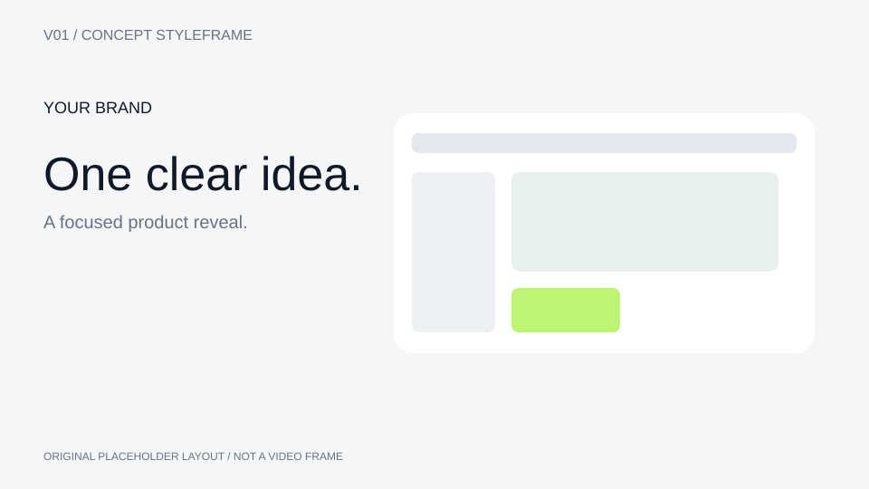
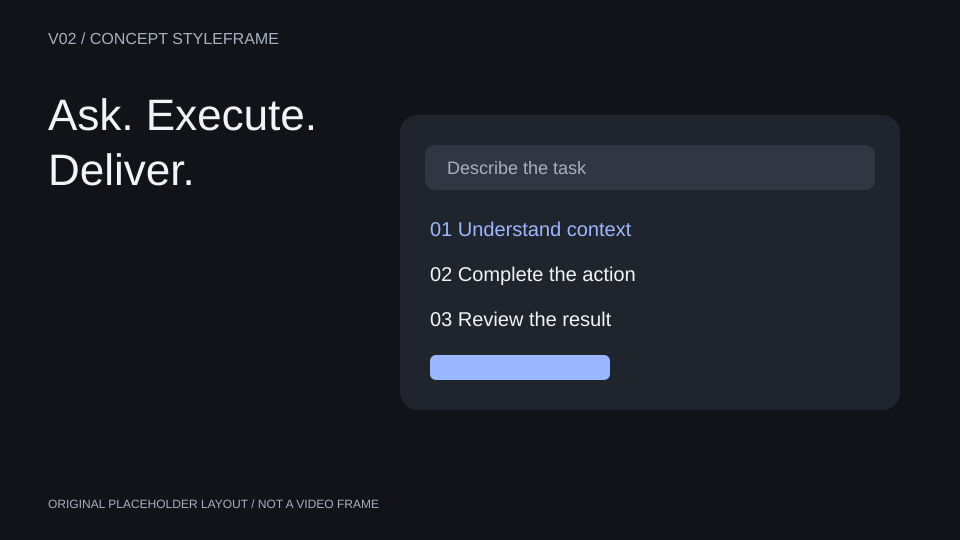
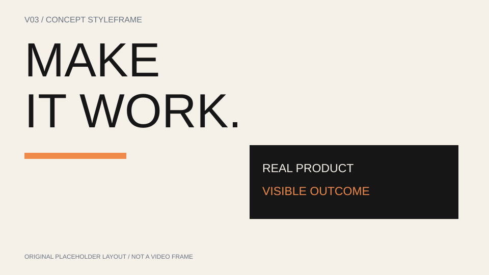
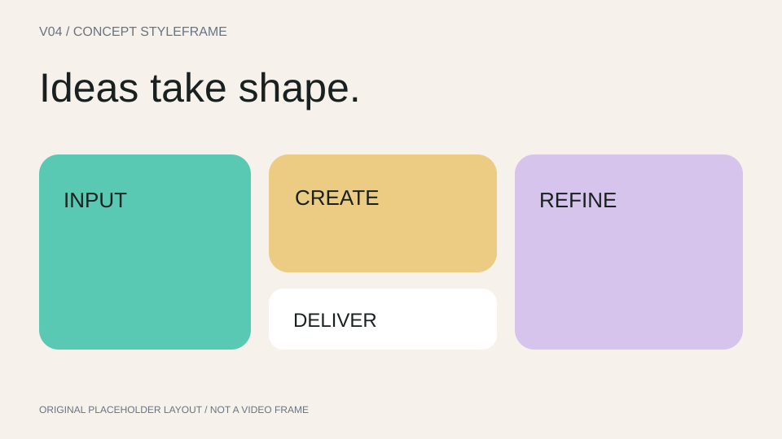
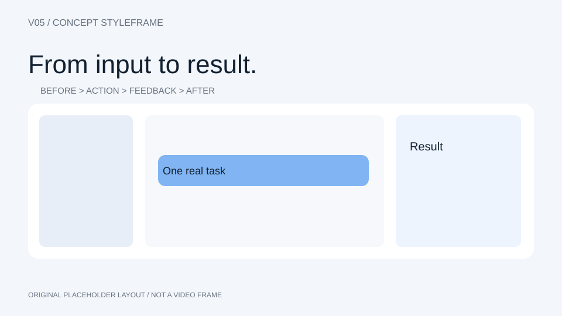
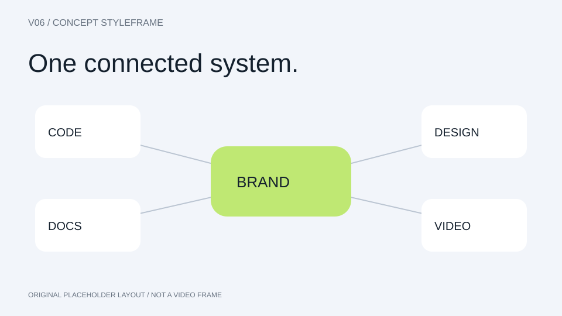
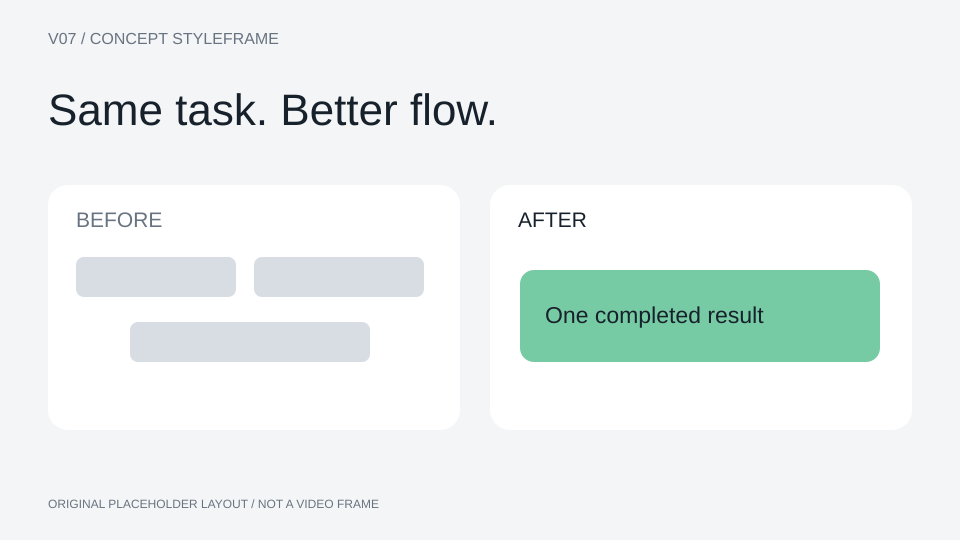
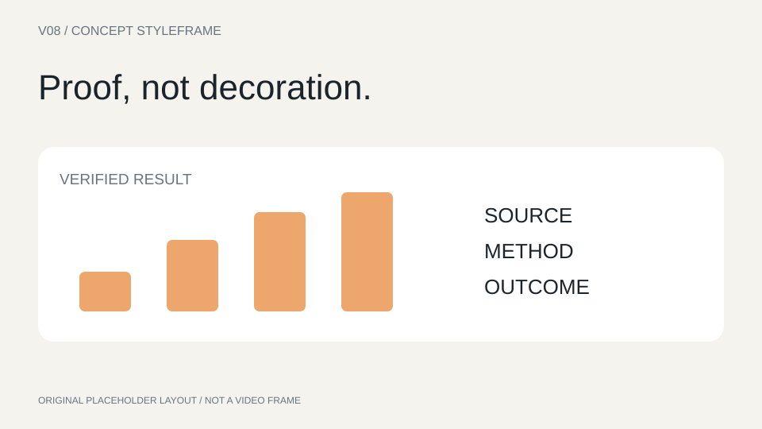

# 多风格分镜库

## 选择流程

1. 先读当前任务和品牌约束，再按目标、受众、素材与声音选择。风格（外观/运动）、叙事（信息顺序）、制作方式（实现工具）分别记录。
2. 用户明确指定风格ID或已确认的参考时直接采用，不强制再选；已有分镜只适配样式与动作，不重排。新视频尚未选方向时不得生成MP4、全量视频素材或直接进入合成。
3. 对全新视频且风格未明确的任务，**必须**推荐匹配的A/B/C三个方向并停止等待用户选择；每项给创意主张、叙事方式、色彩材质与构图、2–3个代表镜头、建议时长、素材需求和难度。推荐一项并说出原因，但不能代替用户决定。用户明确授权“不要选项，风格你定直接制作”时才可跳过选择。单说“帮我做视频”“直接做”不算授权。
4. 展示静态示意图和6镜分镜摘要；示意图是原创占位布局，不是真实产品UI、参考片截图或动态验收。动态质量须另做测试。
5. 每项目采用一个主方向；必要时最多混用一个相容的次方向，统一字体、色板、材质与缓动。当前明确风格优先于个人默认，但禁用人物等其他要求仍需遵守。
6. 查看 [storyboard-library.md](storyboard-library.md) 的对应V编号完整分镜，并读 [source-catalog.md](source-catalog.md) 核对参考证据。时间均为可调整的30秒起步模板，不能压缩口播来硬凑。

## 风格索引

| ID | 风格 | 适用任务 | 视觉与运动 | 素材门槛 |
|---|---|---|---|---|
| V01 | 浅色极简发布 | 高端软件、品牌首发、官网首屏 | 白灰底、黑色大字、少量品牌色；单一产品主角；缓慢推进、遮罩揭示、小幅空间转正；不靠全片淡入淡出 | 高清主界面、Logo、一个可展示的功能前后状态 |
| V02 | 深色技术特写 | 开发工具、工程平台、技术型AI Agent | 深石墨底、精确字阶、低亮度边缘层次；UI局部斜拍、焦点跟随输入、平面到空间的连续推进 | 可读深色UI或获准的深色概念段、真实任务与结果 |
| V03 | 字体节奏宣言 | 短版发布预告、品牌口号、社交传播 | 强字阶、清楚栅格、黑白或单品牌色；文字遮罩、排版重组、关键词与UI形状匹配；禁连续纯字卡 | 短文案、Logo、至少两处真实产品或成果视觉 |
| V04 | 彩色模块创作 | 设计工具、创作平台、年轻消费软件 | 两到三种品牌色、平面模块、清晰圆角与栅格；模块拼合、裁切变化、轻弹性与错峰；不每个元素都跳 | 可拆分的作品、组件与真实界面，明确品牌色 |
| V05 | 真实工作流演示 | 功能发布、上手演示、需要证明可操作性的AI产品 | 以真实UI为主，背景和标注克制；状态前→操作→反馈→状态后，指针与焦点服务步骤 | 真实录屏或完整前后状态、任务输入与最终产物 |
| V06 | 空间生态总览 | 多产品套装、平台能力、多个工作空间的连接 | 中性空间底、统一卡片材质、品牌中心与专业模块；分散到编组、局部到全局、主体间传递；不只旋转卡片墙 | 各产品Logo与界面、经核实的平台关系 |
| V07 | 痛点与前后对比 | 效率工具、流程改进、迁移与替代场景 | 统一背景下明确的前后状态，对比以信息组织而非贬低他牌；同一任务跨状态匹配、遮罩对比、从分散到归一 | 同一任务的可比较素材、真实结果、可核实差异 |
| V08 | 数据与成果证明 | B2B平台、分析产品、案例复盘、需要可信证据的发布 | 清晰数据字阶、克制图形、成果物与指标同屏；从原始资料到图表再到可读结论，数字变化有来源 | 数据来源、时间范围、统计口径、真实成果；缺指标可改用非数值成果证据 |

## 原创静态风格示意

用来比较色彩、构图和信息层级，不能当作已实现动效。适配实际项目时替换全部占位文字与图形。

### V01 浅色极简发布

### V02 深色技术特写

### V03 字体节奏宣言

### V04 彩色模块创作

### V05 真实工作流演示

### V06 空间生态总览

### V07 痛点与前后对比

### V08 数据与成果证明

## 跨风格的质量要求

- 功能演示至少包含一个“状态前→操作→反馈→状态后”的可验证链路。品牌概览没有实操素材时明确其性质，不冒充操作演示。
- 默认避免连续3镜都是同一“左标题＋右截图＋淡入”的版式；系列化展示确需重复时说明目的，用相机、状态或主体关系形成进展。
- 每镜至少有一个服务叙事的变化：操作状态、构图焦点、成果展开或关系传递。纯装饰漂浮不能代替功能变化；落定后可静止阅读。
- 品牌收尾建议至少1秒稳定可读；UI信息密集镜头优先正视，倾斜只在仍可读时使用。
- 素材不足先减少镜头范围或交付概念稿，不能靠换标题和假数据伪造完整过程。
- 同一视频不同镜头的风格可以有节奏变化，但产品身份、字体、品牌色和空间方向应一致。
